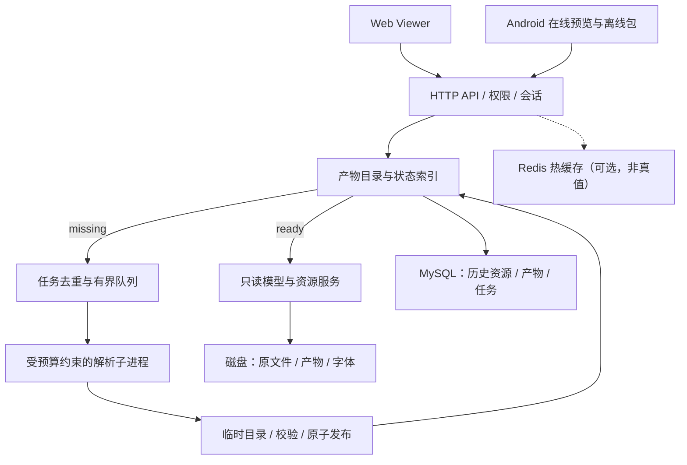

# Web / Android / 解析服务整体优化方案

> 文中异步创建均指 `POST /v1/sessions` 携带 `Prefer: respond-async`；省略该请求头时同步创建。模型单元通过 `?representation=model` 读取；默认完整单元接口返回渲染树。

> 本文接口名称与配置按 [API v1](./api-v1.zh-CN.md) 统一整理；历史测量结果保留，不代表新一轮验收。

> 本文保留原设计或当时验证条件；当前三端职责、已知边界与测试入口请参阅[架构主文档](runtime-workflows.zh-CN.md)、[运行边界](runtime-boundaries.zh-CN.md)和[测试指南](testing-guide.zh-CN.md)。历史数字不自动代表当前结果。

日期：2026-11-06，更新：2026-11-10。状态：分阶段实施中，已完成项与验证边界见 [实施进度](parse-optimization-progress.zh-CN.md)，量化完成度与剩余缺口见 [完成度评估](parse-optimization-completion.zh-CN.md)。基线：单机 8 核 CPU、16 GiB 内存，已有本地磁盘及可选 MySQL；Redis 为可选热缓存，不改变真值路径（见 5.1）。

## 1. 目标与决策

把目前“每次打开创建一个常驻解析 worker”改为“文件与解析产物持久化，阅读会话引用产物，计算任务按需调度”。

必须达到：

- 同一文件、同一解析版本在并发访问中只构建一份产物；历史访问和服务重启后命中产物，不重新执行文件解析。
- 关闭页面、会话过期只释放临时状态，不删除历史文件和共享解析产物。
- 内存中的解析任务数与在线阅读人数分开限制；大任务排队时，已缓存文档仍可阅读。
- Web 和 Android 共享可版本化的模型、资源引用与离线包契约。
- 下载失败、任务崩溃、磁盘写满和进程重启不能把半成品当成成功结果。

首期使用单机磁盘存大对象、MySQL 存索引；开发模式保留文件索引适配器。消息中间件和分布式存储仍不引入。Redis 仅作为**可选的跨实例热缓存**（预览帧、构建进度投影），未配置即完全关闭，且不承载任何真值：ready 指针、租约、配额与产物索引仍只以 MySQL 和磁盘为准（见 5.1）。存储接口预留对象存储适配能力，当前不承诺多实例共享本地目录。

## 2. 优化前的问题与代码依据

| 现状                                                     | 影响                                                | 主要位置                                              |
| -------------------------------------------------------- | --------------------------------------------------- | ----------------------------------------------------- |
| 会话在 worker 打开后才登记                               | 并发绕过 maxSessions；已复现上限 1 时三个请求均成功 | `apps/parse-server/src/server.ts:handleCreateSession` |
| 会话持有一个 worker；PPTX 每分钟续期                     | 空闲阅读占用计算资源，默认 8 个会话容易成为人数上限 | `pptx.ts`、`pptx-model-session.ts`                    |
| PPTX 模型主要在 worker 内，DOCX chunks 按 sessionId 存放 | 新会话不能共享产物，历史打开重走解析                | `pptx-core.ts`、`docx-chunks.ts`                      |
| 删除/清扫会话同时删除 DOCX chunks                        | 历史缓存随临时会话消失                              | `server.ts:handleSession / sweeper`                   |
| DOCX 先下载完整 blob 才判断远程分块                      | 首屏等待与整文件资源开销                            | `apps/viewer/src/web/docs-server.tsx`                 |
| DOCX 全量 XML、slices、blocks 后才落盘                   | 分块传输没有解决服务端解析峰值                      | `docx-worker.ts`                                      |
| DOCX cursor 提前提交、无心跳、媒体无签名                 | 失败重试缺段，空闲过期，鉴权部署图片加载失败        | `docs-remote.tsx`、`docx-worker.ts`                   |
| 默认原文件保留 7 天，按上传时间清理，20 GiB 容量回收     | 不符合长期历史资源语义                              | `server.ts:runGc`                                     |
| Android 仅下载 PPTX，全部完成才打开                      | 尚无 PDF/DOCX 闭环，大媒体影响首次打开              | `android-demo/.../BundleDownloader.java`              |

另需修复 `bin.ts` 将未设置的 limit 以 `undefined` 传入，而 `resolveLimits` 直接对象展开覆盖默认值的问题。所有配置必须按字段校验有限正数和上下界；不能依赖 `Number(value) || undefined`。

## 3. 目标结构



虚线为可选热缓存：缓存丢失只影响首屏与轮询开销，不影响 ready 判定、单元读取与正确性；所有 miss 或故障都回退到 C / M / D。

HTTP 主进程负责鉴权、流式上传、会话与调度，不执行大 XML 解析或大型同步压缩。解析阶段落盘后子进程退出；缓存读取不需要解析进程。

当前 worker_threads 的 V8 堆限制不能作为整进程 RSS 上限。目标采用独立 Node 子进程，通过平台进程监控或 Linux cgroup 限制其 RSS；杀死单个任务不会误杀整个 HTTP 服务。迁移初期可保留 worker_threads 入口，但必须标明尚无硬 RSS 隔离。

## 4. 数据身份与持久化格式

### 4.1 三种身份

- `fileId`：原始字节 SHA-256，继续复用现有内容寻址。上传去重不代表解析缓存已就绪。
- `artifactKey`：规范化输入的 SHA-256，输入包含 fileId、格式、解析器构建指纹、模型 schemaVersion、影响模型的 options。禁止把密码、token、server URL、sessionId 纳入持久化模型。
- `sessionId`：一次阅读的临时引用，可带阅读位置、布局偏好；不拥有共享文件和产物。

构建指纹由构建系统产生并纳入相关解析依赖版本，不能长期固定为现有 `0.1.0`。options 统一默认值、键排序和序列化后再计算哈希。

模型缓存不包含浏览器测量结果。可选布局缓存另用 `artifactKey + rendererVersion + width + fontSetHash + measurementProfileHash` 标识；设备实测字宽放在会话范围，不能污染所有用户共用的模型。

### 4.2 目录

```text
files/<hash前两位>/<fileId>          # 沿用现有原文件布局
artifacts/<key前两位>/<artifactKey>/
  manifest.json                    # 发布清单、版本、单元索引、依赖、校验和
  document.json                    # 尺寸、样式、章节、字体表、警告等共享信息
  units.bin                        # 独立压缩帧，按偏移读取 PPTX 模型或 DOCX chunks
  fonts/<fontHash>.sfnt
staging/<jobId>/<attempt>/          # 未发布产物，不对普通读取接口可见
```

沿用 `docx-chunks.ts` 的压缩帧与偏移思路，抽出通用 ArtifactReader / ArtifactWriter。Writer 接受增量单元，禁止要求完整 `unknown[][]` 才能写入。大单元的展开字节、压缩比和响应大小都需限制；DOCX 可以继续细分 block chunk，超大单一 block 须明确拒绝或使用可验证的拆分协议，不能静默截断。

manifest 至少包含：artifactKey、fileId、schemaVersion、parserFingerprint、format、unitCount、每单元的 offset / compressedLength / rawLength / sha256、font 清单、资源依赖、构建时间、总字节、warnings。文件引用与解析产物均可校验。

### 4.3 模型序列化和资源引用

持久化 DTO 必须是显式定义的 JSON 数据结构。Map / Set、typed arrays 等由编解码器转换，不可直接对引擎运行对象 JSON.stringify 后当成稳定协议；覆盖图表、组合形状、主题、动画、链接与字体的 round-trip 验证。

图片、视频、音频等保存 `assetId + fileId + partPath`，派生图片和字体保存独立内容哈希。响应适配层根据当前 origin、权限和签名有效期生成 URL。禁止在缓存中保存 bearer token、绝对部署域名和 exp/sig。

原文件内的媒体继续按 part + Range 读取，产物依赖原文件。引擎当前生成的 data URL 逐步迁移到独立资源，避免模型重复携带大字节。

外链媒体独立标记 external：默认保留外链并声明离线不可用，不将所有外链当作内部资源下载。需要离线镜像时另行实现大小、重定向、来源和完整性约束。

## 5. MySQL 索引与一致性

| 表                      | 关键字段和约束                                                                                                                  |
| ----------------------- | ------------------------------------------------------------------------------------------------------------------------------- |
| `parse_files`           | 保留原字段，增加存储状态和校验状态                                                                                              |
| `library_entries`       | id、libraryScope、fileId、displayName、retention、deletedAt；表达用户保存的历史记录                                             |
| `parse_artifacts`       | artifactKey 主键、fileId、fingerprint、schemaVersion、state、generation、storagePath、bytes、unitCount、lastAccessAt、errorCode |
| `parse_jobs`            | jobId、artifactKey、state、attempt、leaseOwner、leaseUntil、generation、progress、errorCode；索引 state / leaseUntil            |
| `parse_sessions`        | 保留 sessionId，增加 artifactKey、expiresAt、布局偏好；逐步移除 baseUrl、完整 model/fonts 副本                                  |
| `artifact_dependencies` | artifactKey、依赖类型、依赖 ID；GC 判断原文件与资源的存活依据                                                                   |

当前只有服务级 token，libraryScope 首期采用实例级库；多用户归属必须接入可靠身份后再启用，不能信任客户端随意传入的 ownerId。已知 fileId 不构成访问授权，内容去重也不能直接授予历史资源权限。

`parse_artifacts` 对 artifactKey 的唯一约束及事务负责跨请求任务去重；不能只用内存 Map。事务锁定产物行，确认无有效构建者后更新 lease 与 generation。任务续租，发布时校验 generation，旧任务即使迟到也不能覆盖新产物。

发布次序：临时写入 → 文件 flush、关闭并完成校验 → 同文件系统 rename 到不可变 generation 目录 → 数据库事务设置 ready 和路径。数据库只指向已完整发布的目录。文件系统与数据库没有统一事务，启动对账负责清理“已落盘但未登记”的孤儿目录、修复失效 ready 指针。文件索引适配器仅支持单服务进程、原子索引文件和内存 single-flight，不宣称具备 MySQL 多写入者保证。

### 5.1 Redis 热缓存层（可选，非真值）

首版 Redis 只做两件事：跨实例共享**预览帧**与**构建进度投影**。`parse_*` 表与磁盘 generation 仍是唯一真值；未配置 `redis`（与 `mysql` 同级的可选配置）时完全关闭，单机默认 `mode=memory`，不新增必选依赖。

**启用判据**：只有部署 ≥2 个实例、且确实出现跨节点首屏或轮询打库压力时才启用 `mode=redis`。单机部署不启用。health 暴露 `cache.mode`，运维可确认实际模式。响应缓存、会话状态投影与分布式限流列为“待评估”，不进入首版；它们与现有队列、签名和租约语义重叠，收益需先测量。

**禁止进入 Redis**：ready 指针与 generation 归属、构建/读取/下载租约、配额与压力账本、原文件与产物索引、库保留策略。这些数据丢失会造成超卖、脏读、重复撤下或误删，继续由 SQL 条件更新、不可逆授权和文件校验承担。Redis 锁不得替代 `withdrawReady` 的 compare-and-clear，507 判定与租约续期也不得依赖 Redis。

| 数据     | Key / 结构                                                | TTL   | 丢失影响             | 写入时机               |
| -------- | --------------------------------------------------------- | ----- | -------------------- | ---------------------- |
| 预览帧   | `pv:{artifactKey}:{jobId}`，Hash(document、unit:i、count) | 60 s  | 无首屏，返回 pending | 帧提交后               |
| 构建进度 | `job:{jobId}`，Hash(unitsProduced、unitCount)             | 5 min | 进度回退到 SQL       | 逐帧或全局 200 ms 节流 |

- key 必须绑定 `jobId`：重建、重试和解析器升级都会生成新 jobId，旧 key 由 TTL 清理，不做跨代 invalidate，也不存在“旧预览盖住新构建”。
- 预览仍受 `previewMaxUnits`（默认 8）约束，不因 Redis 容量放大。单个 field 超过 256 KiB 的单元不写入缓存，该单元回源 generation；`document` 超限则该次构建不提供跨节点首屏，而不是拆分或截断。
- Redis 只用于**否定**（无预览、未就绪、进度缺失）。任何肯定 `ready` 的判断仍必须走 `claim` / 读租约与 ready 指针校验；命中缓存不得跳过这一步。
- 写入次序：帧提交 → 写预览 → 全部单元/字体完成 → 发布 manifest → SQL 置 ready → 才允许写其他缓存。构建失败或取消立即删除 `pv` / `job`，未发布内容绝不标记 ready。
- 进度只由构建节点写；节流按进程全局计算（不是每个构建各 200 ms），构建结束时强制写最后一次；读取取 `max(redis, sql)`，Redis 缺失时回落 SQL。
- 命令超时 50–100 ms，请求路径最多一次、不重试；连续失败熔断 5 s 后半开。读 miss/超时回源 MySQL 或磁盘，写失败只记指标，不得让上传、解析或读取返回 5xx。
- 必须注入的故障：宕机、`FLUSHALL`、慢而不死（p99 500 ms）、连接池耗尽、主从切换、同刻大量过期、单 key 热读。全部只允许降级，不允许 5xx 或状态变更。
- SLO：启用后预览/进度读取的缓存命中率 ≥80%，附加 p95 延迟 ≤5 ms，缓存错误率 ≤0.1%。未达标就切回 `memory` 并记录结论，不把“可选缓存”留成长期负债。
- 清空、驱逐与主从切换一律视为 cache miss；Redis 不备份、不进入恢复演练，正确性仍由备份清单与 MySQL/磁盘校验保证。
- 内存 ≤1 GiB，从 6 GiB 余量划出，并给 OS/MySQL/页缓存保留 ≥4 GiB；不计入解析与 HTTP RSS。`maxmemory` + `allkeys-lru`，key 前缀 `genoffice:{dbScope}:`，生产启用 TLS + ACL。
- 回滚 = 切回 `mode=memory`，Redis key 靠 TTL 过期，不做数据迁移，也不得因回滚删除任何持久数据。
- 观测：`cache_hit/miss/error/timeout`、`cache_latency`、`cache_evictions`；`cache_bytes` 用 exporter 或 `MEMORY USAGE` 采样，不直接依赖 INFO 字段。health 暴露 `cache: {mode: memory|redis, hitRate, errors}`，Redis 故障不改变请求成败。

**P3.5 交付边界**：只做可关闭的最小实现——单实例 Redis、TLS/ACL、`maxmemory` 与上面两条 key；Sentinel/Cluster、容量演练、告警与灰度并入 P4，不在本阶段承诺高可用。

## 6. 任务状态、故障与资源调度

状态：`queued → building → ready`；异常转为 `failed` 或 `cancelled`，租约过期任务经恢复检查重新入队。构建中的首批单元可标记 `previewable`，但完整产物 ready 只能在全部校验后设置。状态机以 `parse_artifacts` / `parse_jobs` 的事务与租约为准；Redis 中的进度只是投影（5.1），不得用于肯定 ready，缓存丢失或回退也不得改变任何任务状态。

- 同一 artifactKey 的所有访问共享任务；等待者取消只取消自己的订阅。
- 队列满：已有任务仍可附着、ready 仍可读取；仅拒绝需要新增任务的请求，返回 429 和 Retry-After。
- worker 崩溃、超时、内存超限：记录稳定错误码，释放预占预算，保留可诊断状态。仅对可恢复基础设施错误有限重试；格式错误不自动循环重试。
- 客户端断开：显式保存历史资源的任务继续运行；临时预览无等待者时允许取消尚未开始的任务。取消必须经过调度器，不能由单个会话关闭共享任务。
- 服务退出：停止接新任务，给予运行任务退出窗口，超时终止；重启扫描 lease，恢复排队任务。
- 构建失败不覆盖已有 ready generation。坏单元校验失败标记产物损坏并触发修复；请求得到可重试状态，不能返回残缺文档作为成功。

### 6.1 8 核 16 GiB 初始预算

以下是建议起点，必须由真实文件压测调整，不是在线人数或性能承诺。

| 项目                          | 初始值         | 说明                                                                     |
| ----------------------------- | -------------- | ------------------------------------------------------------------------ |
| 重解析并发                    | 2              | 同时满足计数与总内存预算才启动                                           |
| 解析子进程总 RSS 预算         | 8 GiB          | 单任务按类别预留，未知大任务保守预留 4 GiB                               |
| HTTP / 索引 / 读缓存目标预算  | 2 GiB          | 内存 LRU 必须按字节限制；初始模型热缓存 256 MiB                          |
| 操作系统、MySQL、页缓存和余量 | 6 GiB          | 与总进程 RSS 一起监控，防止页缓存及数据库挤占                            |
| 其中 Redis 热缓存（可选）     | ≤ 1 GiB        | 从上一条余量划出，且给 OS/MySQL/页缓存保留 ≥4 GiB；不计入解析与 HTTP RSS |
| 等待队列                      | 20 个唯一任务  | 缓存命中不占队列；后续补调用方公平配额                                   |
| 临时阅读会话上限              | 初始 500       | 只存轻量状态，需以 500 会话压测验收；超限独立返回错误                    |
| 会话空闲 TTL                  | 30 分钟        | 60 秒心跳；不影响持久化产物                                              |
| 原文件与产物容量              | 部署时显式配置 | 磁盘容量未知，不沿用 20 GiB 当生产建议                                   |

V8 heap 上限应小于 RSS 上限并经测量配置，不把现有 512 MiB 当作大文件通用值。补采子进程 RSS、外部内存、解析阶段与模型体积；预算达到阈值停止新任务，越界终止具体任务。并发从 2 提升到 3–4 仅在峰值与延迟指标通过后进行。

PDF Range 和持久化产物读取不占重解析名额；另外设置 HTTP 并发、磁盘 I/O 和解压工作池上限，避免把“无解析 worker”误认为读取零成本。复杂服务端排版使用独立低优先级队列并计入同一总 RSS 预算，不能额外无界启动进程。

## 7. HTTP 契约与兼容迁移

接口统一使用 `/v1`。同步创建保持 201 ready；携带 `Prefer: respond-async` 时启用异步任务，冷解析返回 202、缓存命中返回 201。capabilities 声明异步任务、模型 schema 和离线包能力；内部等待有明确超时，失败返回明确错误。

```text
POST   /v1/files                         流式上传，返回 fileId
POST   /v1/library                       显式保存历史记录（fileId、displayName）
POST   /v1/sessions                      校验访问；命中返回 201 ready，未命中返回 202 queued/building
GET    /v1/sessions/:id                  state、artifactKey、progress、pollAfterMs、错误与恢复信息
GET    /v1/sessions/:id/document         文档共享信息
GET    /v1/sessions/:id/units?cursor=...  单元列表和可用范围
GET    /v1/sessions/:id/units/:unitId    模型与当前请求的资源访问描述
POST   /v1/sessions/:id/heartbeat        仅续期轻量阅读会话
DELETE /v1/sessions/:id                  只删除阅读状态
GET    /v1/sessions/:id/bundle-manifest  可版本化的离线下载清单
GET    /v1/library?cursor=...            历史资源列表
DELETE /v1/library/:entryId              删除库引用；后台按依赖和策略 GC
```

冷访问返回 Location 指向会话状态，客户端遵循 pollAfterMs 带退避轮询；首期不依赖 SSE。相同文件附着已有任务时返回相同 jobId，但 sessionId 独立。会话过期可凭有权限的 fileId 重新打开命中产物，恢复客户端锚点。

所有 POST 支持业务幂等键或唯一关系去重。range、HEAD、ETag、鉴权签名保持一致；签名过期可通过会话刷新资源描述，缓存本身不失效。带短期签名的 JSON 使用私有短缓存或 no-store；规范化模型可用 artifactKey 校验缓存，避免混用两者 ETag。共享 Redis 不缓存带签名的完整响应（响应缓存暂不启用，见 5.1）；签名和 origin 始终在出站时生成。

阶段式输出不修改已发布单元；未生成单元返回明确的 pending 状态与重试建议，完整 manifest 才可用于离线完成判定。首期先全量 ready 发布，增量可预览后续实现，避免同时引入过多状态。

## 8. 三端流程

### 8.1 Web

1. 将格式策略集中：DOCX 超过 32 MiB 的 auto 走服务端，PPTX 初始保留 64 MiB 阈值；读取 capabilities 后匹配可用能力。无后端时提前提示限制。
2. fileId 直接创建会话并检查缓存；URL 导入按流读取并计数，声明长度仅作预检。已知本地 File 先按 size 校验；未知扩展名不在检查前读取整文件。
3. 服务端 DOCX 根据文件元数据与明确渲染策略决定路径，超过阈值不先下载 blob。手动 server 模式实际使用远程模型，小文件保真回退须显式配置并说明。
4. PPTX 默认客户端 Worker 读取持久化模型并排版；浏览器字体度量和当前可见页缓存继续留本地。持久化缓存命中不需要服务端重新 openPptx。
5. DOCX chunk 成功后再原子提交 cursor、blocks 和 hasMore；按 chunkId 去重。错误重试同一 chunk，成功清错误；会话失效重建并恢复锚点。
6. DOCX 渲染窗口之外需要模型缓存预算，不能仅虚拟化 DOM 却一直追加全部 blocks；使用按 chunk 的有界 LRU、页范围索引和重新获取。图片/字体就绪引发测量失效，表格测量使用真实样式上下文。
7. 持久化内容缓存与短期资源 URL 分离；页面关闭清理请求、worker 和心跳。新增等待状态：排队、解析中、可预览、失败可重试。

### 8.2 服务端逐格式

- PPTX：第一阶段保留 slim + openPptx，解析后逐页导出显式 DTO 和播放信息，再关闭子进程。首次全量建模时间仍存在，后续逐步优化为按页增量。旧 `layout=server` 保留可选排版队列，字宽反馈属于会话，不改共享模型。
- DOCX：先把已存在 chunk、样式、节信息、字体表迁入产物。随后用 ZIP entry 解压流直接驱动 tokenizer，一次保留有限 block；移除全量 XML、slices 和 blocks，增量写 units.bin。跨块编号、表格、修订、脚注、页眉页脚和分节必须做语义一致性验证。
- PDF：优先复用原文件 + Range，不为已有 PDF 预览虚构模型解析步骤。缩略图、文本索引等将来按独立派生任务和版本缓存。
- 加密文档：现阶段能力未定义，入口明确返回需要密码/不支持；后续独立设计解密任务、密钥生命周期和缓存访问范围，不能把明文密码持久化。

### 8.3 Android

第一阶段明确仅支持 PPTX，下载前检查格式和 schema 兼容性。改用服务端 bundle-manifest，包含 artifactKey、schemaVersion、每资源大小/哈希、内部资源清单和 external 警告；不靠递归搜索 URL 来推断全部依赖。

缓存目录按 artifactKey 区分版本，保留 fileId 到当前包的引用。保留现有 staging → complete → publish 思路；验证所有必需资源后才标记 complete。断点续传必须校验 ETag 和 Content-Range，服务端忽略 Range 时从头写，禁止盲目追加。

第二阶段支持“在线首屏可用、后台下载”；未缓存资源可在线取，断网显示尚未离线就绪，不伪装完整离线。提供取消、磁盘剩余空间预检、下载进度、缓存大小和清理入口。更新失败继续使用旧完整包，启动时恢复 `.previous` / staging 异常状态。

设备本地服务将缓存模型中的 assetId 映射为 loopback URL，在线签名不写入离线包。设备包持有自己的资源字节，服务端 GC 不影响已完整下载的包。PDF 和 DOCX 移动预览另立适配任务，不自动宣称三格式已完成。

## 9. 保留、删除与 GC

必须分开设置：

| 类型                   | 策略                                                                           |
| ---------------------- | ------------------------------------------------------------------------------ |
| 显式保存的历史原文件   | 默认保留至用户删除；占用库配额，不能被临时 TTL 自动清除                        |
| 历史文件当前解析产物   | 正常容量范围保留；压力下允许回收可重建产物，历史记录继续显示原文件仍在、需重建 |
| 临时文件和解析产物     | 初始按最后访问 7 天回收，访问时间写入合并，避免每个资源请求更新数据库          |
| 老解析版本             | 新版本构建成功后再回收；存在阅读或下载租约时延迟                               |
| staging 和失效任务残留 | lease 失效并超过宽限期后清理，运行中的目录不能清除                             |

普通关闭会话不删除产物。GC 使用库引用、产物依赖、构建/下载租约和短期读取租约判断存活，而非只看在线会话。先把产物状态切换 deleting 阻止新引用，再等待读取租约结束，删字节、更新索引；失败可幂等重试。原文件只有在没有历史引用、活跃任务、读取租约和存活产物依赖时才可删除。

容量达到高水位先回收临时和旧版本产物；没有可回收空间时拒绝新增上传/构建，不静默删除用户保存的原文件。部署前必须确定磁盘容量、配额和高低水位，保留紧急空间用于原子更新与日志。

持久化不等于备份：MySQL 与原文件、产物目录需要一致的备份清单及恢复演练。原文件和库索引优先保证可恢复；派生产物允许重建。恢复后执行依赖对账、校验文件存在性，未通过检查的结果不能宣称 ready。Redis 不参与保留与 GC 决策：清空、驱逐或丢失 Redis 不得删除任何原文件、产物或索引行。

## 10. 实施拆分和迁移

| 阶段            | 改动                                                                                       | 退出条件                                                        |
| --------------- | ------------------------------------------------------------------------------------------ | --------------------------------------------------------------- |
| P0 正确性       | 并发预占、恢复 single-flight、配置默认值校验、DOCX 签名/游标/心跳、自动阈值与下载前分流    | 对应回归通过；保留现有接口行为                                  |
| P1 持久化基础   | Artifact DTO/Reader/Writer、MySQL 表和文件索引、依赖关系、原子发布、PPTX/DOCX 完整产物落盘 | 新会话和重启命中产物时解析启动数为 0                            |
| P2 资源解耦     | v1 异步任务、有界队列、租约、子进程 RSS 隔离、会话只引用产物、Web/Android 等待状态适配     | 大任务排队不阻断缓存读取；客户端兼容迁移完成                    |
| P3 大文件与体验 | DOCX 真流式、前端有界 chunk 缓存、增量首屏、Android 清单/续传/容量管理                     | 大正文和弱网场景达标，记录峰值内存与首屏数据                    |
| P3.5 可选热缓存 | 预览帧与构建进度的跨实例共享；单机默认 memory，Redis 可关闭                                | 双实例 A 构建/B 读首屏；宕机、清空或变慢不影响 ready 与单元读取 |
| P4 运维上线     | GC、配额、备份恢复、指标告警、灰度与故障演练                                               | 压测与恢复报告可复查，可回滚                                    |

P1 的持久化不是 P3 的低峰值解析，两者分别验收。P1 初期仍可能冷解析耗时较长，不能提前宣称完整 GB 正文能力。

现有原文件保持路径与 fileId。旧 sessions/chunks 不批量直接改名为可信新产物；新访问优先检查新缓存，缺失再构建。可做受队列预算约束的后台历史预热。旧 chunk 仅在版本匹配且结构/依赖校验通过后导入，否则重建。

数据库迁移先加表/列，不直接删除旧列。新功能按 artifactStore、asyncSessions、processWorkers 开关分批启用，保留旧客户端路径。回滚前停止新任务并排空写入；回滚版本必须继续识别库保留标记，或暂停旧 GC，防止旧清扫器删除新历史库的文件。新增产物可留盘，不能为了回滚删除用户原文件。

建议按阶段拆成独立 PR，P0 可以立即开始；P1 先实现产物编解码与缓存命中，再接调度。具体工期在 DTO 保真与流式 DOCX spike 后估算。

## 11. 验证与观测

必须新增以下有区分度的验收：

1. 并发 3 次创建、解析上限 1：运行中重任务不超过 1；相同 artifactKey 只启动一次解析，独立文件按队列执行。
2. 首次解析完成后关闭全部会话、重启服务再打开：PPTX/DOCX 读取成功，解析进程启动计数增量为 0，媒体及字体可读取。
3. 上传同文件多次、多个会话、多个解析版本：去重正确，版本隔离，关闭一个会话不影响其他读取；私有字宽不互相覆盖。
4. 写盘中断、电量/进程故障、磁盘满、数据库提交失败：不存在半成品 ready，旧 generation 可用，对账后无永久孤儿占用。
5. lease 超时后旧进程迟到发布：generation 检查拒绝旧写入，不破坏新产物；取消一个等待者不取消共享构建。
6. token 开启、资源签名过期、换部署域名：正文图片/音视频/字体均可通过刷新描述继续访问，缓存文件不含 token 和失效 URL。
7. DOCX chunk 请求失败并重试、会话空闲过期重建：不丢块不重复，阅读锚点恢复；图片与字体迟到后分页重新测量。
8. Android 哈希错误、磁盘不足、Range 不支持、下载中断、更新中退出：不标记 complete，旧包仍可用，恢复后下载不混版本。
9. GC 与构建/读取/下载并发：有依赖的原文件和资源不误删；无空间时拒绝新任务，历史原文件保留。
10. 多格式保真：选真实 PPTX/DOCX fixture 对比模型 round-trip、动画、图片、表格、编号、分节、字体与关键页面截图。
11. Redis 热缓存（仅启用时）：实例 A 构建、实例 B 读取首屏与进度；宕机、`FLUSHALL`、p99 500 ms、连接池耗尽与主从切换下，ready 与单元读取不受影响；缓存值不含 token、签名与绝对域名；未达 5.1 的 SLO 可切回 memory。

性能样本分开：大媒体小正文、压缩率高的大正文、多页复杂 PPTX、巨大单页/表格、嵌入字体、损坏包。1 GiB 媒体占位文件不能替代 1 GiB 正文测试。

8 核 16 GiB 上先测：2 个冷解析 + 20 个排队任务 + 50 个并发缓存阅读，再测 500 个轻量会话。记录 p50/p95 首屏、单元读取、排队时间、解析用时、RSS 峰值、CPU、磁盘吞吐。初始目标为整体 RSS 不超过 12 GiB、缓存命中无解析启动、冷解析不导致健康接口超时；延迟目标由代表性样本基线确定后固定，不凭空承诺在线人数。

新增指标：artifact_hit/miss/corrupt、parse_started、job_queue_depth/age、deduplicated_waiters、worker_rss、reserved_bytes、unit_read_latency、storage_bytes（原文件/产物/staging）、gc_deleted_bytes、signature_refresh、bundle_failure、cache_hit/miss/error/timeout、cache_latency、cache_evictions。日志关联 requestId / jobId / artifactKey / sessionId，避免输出 token、签名和密码。

## 12. 开始实施前的默认假设

- 单机部署、实例级历史库；生产使用 MySQL，本地开发允许文件索引。
- 首期优先 PPTX 与 DOCX 持久化、PDF 原文件复用，移动端先闭环 PPTX。
- 默认并发 2，先修正确性并建立缓存，再做流式和增量首屏。
- 已保存历史资源的原文件不自动按 TTL 删除；临时缓存可回收。
- Redis 为可选热缓存，单机默认 memory，未配置即关闭；缓存丢失只影响首屏与轮询开销，不影响正确性、GC 与恢复（5.1）。
- 磁盘规格、历史库配额、备份位置和目标延迟尚待部署信息确定，不阻塞 P0 与产物格式设计。
