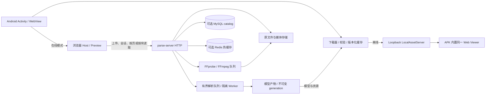
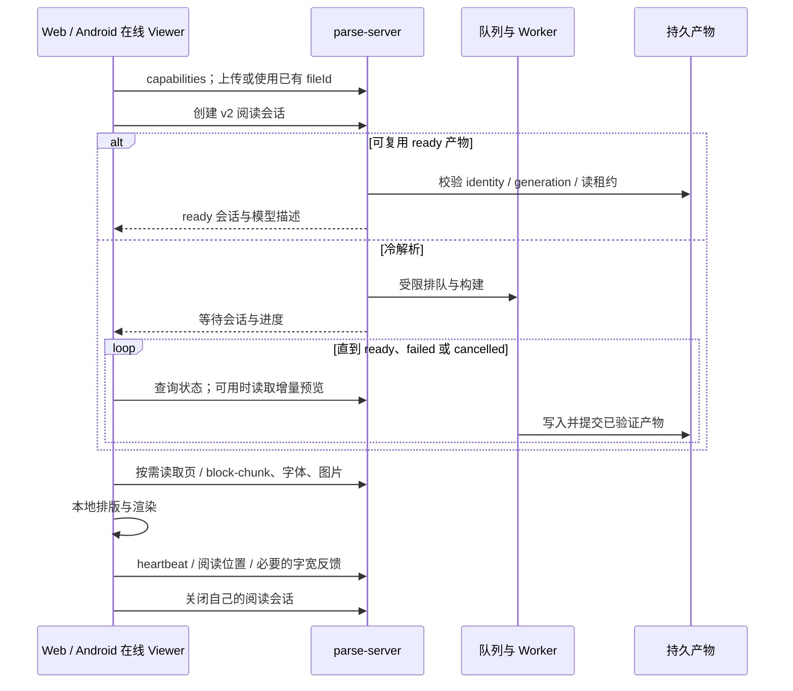
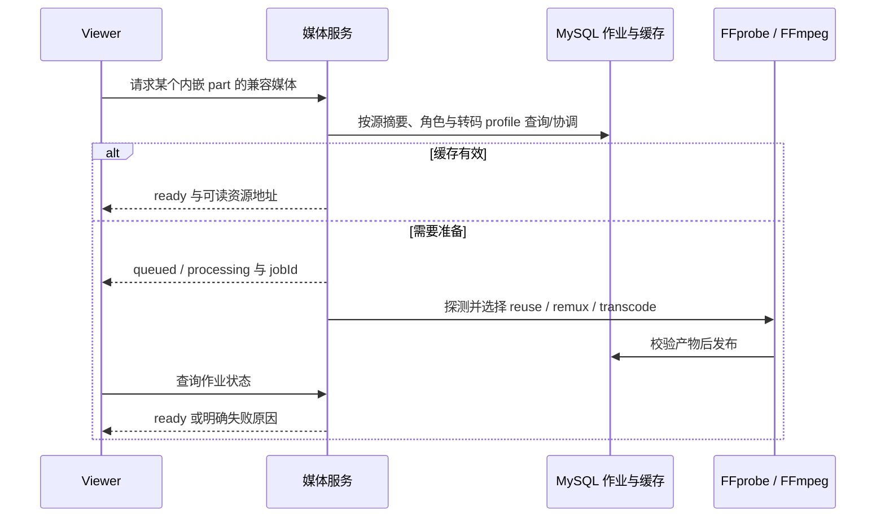
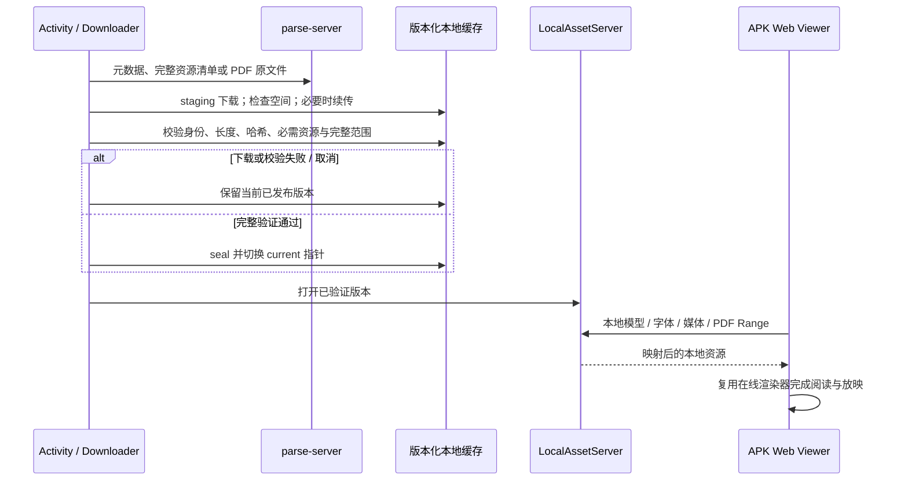

# Web、解析服务与 Android 的功能与架构

更新日期：2026-11-12。本文说明当前代码中的运行方式，不以历史测试数量或完成度百分比作为交付结论。限制见[运行边界](runtime-boundaries.zh-CN.md)，测试入口、精简映射与本轮证据见[测试指南](testing-guide.zh-CN.md)。

## 1. 功能需求与职责

| 能力            | Web Viewer                                                             | parse-server                                                  | Android Demo                                             |
| --------------- | ---------------------------------------------------------------------- | ------------------------------------------------------------- | -------------------------------------------------------- |
| 文件导入        | 本机选择、直链导入、历史资源入口；读取前检查大小与路由                 | 流式上传、内容识别、SHA-256 寻址、元数据、原文件保留          | WebView 文件选择；按 fileId 在线打开或下载               |
| PPTX 阅读与放映 | Canvas 渲染、缩略图、跳页、动画、音视频交互、字体实测                  | OOXML 解析、模型/渲染树按页输出、字体与媒体资源               | 复用同一 Viewer，提供 WebView、全屏和本地资源服务        |
| DOCX 阅读       | 本地完整解析，或远程 block-chunk 与虚拟窗口；连续阅读、注释和完整表格 | 流式正文提取、样式上下文、脚注/尾注、分节/页眉页脚与块模型    | 下载模型、样式、字体和媒体，离线重放远程阅读协议         |
| PDF 阅读        | PDF.js 解析与渲染，支持 URL、签名内容和本地原文件                      | 提供原文件 Range/HEAD/ETag；不是 PDF 页面渲染服务             | 下载并校验 PDF 原文件；本地 Range 服务和打包 PDF.js 资源 |
| 音视频兼容      | 显示准备状态，轮询结果、重试、播放兼容资源                             | FFprobe 检查；兼容媒体复用、必要时重封装/转码，持久队列与缓存 | 下载已准备媒体及映射，离线指向本地文件                   |
| 缓存与恢复      | 当前窗口缓存、签名刷新、会话恢复、阅读位置                             | 持久产物、轻量阅读会话、并发任务协调、损坏检查与恢复          | 断点续传、完整性校验、版本发布、配额和失败保留旧版本     |

三端是只读预览系统。支持格式不代表任意 Office 文件都能逐像素还原；Android Demo 也不等于已完成所有 Android 机型的兼容认证。

## 2. 模块与系统关系

- **Viewer**：`apps/viewer` 是静态站点。Host 负责导入、资源库和参数；Preview 负责格式路由；解析 Worker 与主线程渲染分离。发布目录不需要 Node 服务或 PM2。
- **服务端**：`apps/parse-server` 负责原文件、解析作业、持久模型、读取会话、资源授权和转码。解析并发、排队数量、阅读会话数量和 HTTP/磁盘池是不同限制。
- **Android**：`apps/viewer/android-demo` 负责原生生命周期、下载、存储与本地 HTTP 协议适配；不复制一套独立 Office 排版引擎。
- **共享层**：`viewer-renderers`/`viewer-services` 提供渲染与资源服务快照；`docx-engine`、`pptx-engine`、`pptx-render` 提供解析和模型；`parse-contract`、ZIP 读取与安全校验包提供跨端协议和输入边界。源码一致性测试仍是有效兼容约束。

## 3. 在线打开与排版

### 3.1 路由与兼容

入口通过 `local`、`server`、`auto` 选择路径，结合服务端 capabilities 与部署阈值判断；手动指定的不可用路径明确报错。旧服务或 Android 本地重放不支持 v2 时才回退 v1；队列饱和、鉴权失败和普通服务错误不能通过回退绕过限制。

当前 Viewer 本机文件预检上限为 **1 GiB**；默认 DOCX 自动远端阈值 **32 MiB**，PPTX/PDF 为 **64 MiB**。部署可下发有效阈值。手动 server 的 DOCX 默认读取远程模型，只有显式 `docxLocalFallback=1` 且不超过完整渲染阈值时才下载原文件走完整本地渲染。上限、自动路由阈值和解析内存能力不可混为一谈。

### 3.2 PPTX

默认由客户端 Worker 使用远程解析模型排版，浏览器字体与 Canvas 提供实际度量；`layout=server` 使用服务端渲染树和字宽反馈。首页、可见缩略图、跳页和放映预加载都通过会话接口按需读取。测量更新只影响相关页面，不能重置正在进行的动画。

服务端模型缓存不等于浏览器画布缓存。产物重启后相同模型与实际渲染树/像素等价分别由不同测试验证，不能相互替代。

### 3.3 DOCX

本地完整阅读路径包含 Word 打开密码提示与解密；这不扩展服务端 Office 输入能力，远程 block-chunk 路径仍以服务端支持范围为准。

远程路径依次读取样式与字体、元数据和 block-chunk；只保留有界正文窗口，布局索引保留位置和尺寸。排版前等待字体与图片完成或有限超时；窗口关闭会中止等待。正文按与 `apps/docs` 阅读模式一致的连续视图展示，不生成纸张分页或表格续页，不显示页码和翻页按钮。页眉页脚及脚注/尾注在连续文档首尾呈现；服务端模式仍按源单元保留有界正文窗口，阅读位置通过源块锚点恢复。

表格按源模型连续展示，保留网格、边框和单元格对齐，不生成重复表头或续页片段。嵌套、竖排、精确行高、表内脚注/尾注引用及复杂跨行合并等仍受解析与渲染能力限制，详见运行边界。

### 3.4 PDF

PDF.js 在客户端加载和解析 PDF 字节，并通过密码回调处理打开密码、错误密码重试与取消。在线时由服务端原文件接口提供 Range、HEAD 和 ETag；需要鉴权时先取得签名内容 URL。离线仍由同一 PDF.js 解析，字节来自 Android 本地原文件，不要求联网下载解析后的页面模型。字体、CMap、WASM 等资源必须随 Viewer 打包。

## 4. 媒体自动准备

- 视频目标为 MP4：H.264、兼容像素格式和 profile/level，音轨为兼容 AAC；音频目标为 MP3。策略还检查容器和 faststart，不能只看扩展名。
- 已兼容媒体优先复用；编码兼容而容器不合适时重封装，其余执行受限 FFmpeg 转码。结果缓存、作业租约、失败恢复与客户端播放状态分别管理。
- 媒体服务默认关闭，启用时要求 MySQL。默认同时转换 1 项、排队 64 项；具体预算与超时由媒体配置控制。外链媒体、版权或 DRM 不会因容器转换自动变为可离线内容。

## 5. 持久化与生命周期

| 对象          | 职责与一致性要求                                                                          |
| ------------- | ----------------------------------------------------------------------------------------- |
| 原文件        | 内容寻址保存；Range 和 part 读取的数据来源。被保留的原文件可用于重建丢失产物              |
| 产物 identity | 包含源身份、解析指纹、schema 与归一化选项；排版缓存键另含布局相关参数                     |
| generation    | 不可变发布；读取以租约保护，回收不能删除仍在使用的版本                                    |
| 阅读 session  | 轻量、可关闭和过期；会话数量不等于解析进程数量，单个等待者关闭不应取消其他读者            |
| 解析 job      | 独立的排队、计算、取消与恢复状态；提交 chunk 后才推进读取 cursor                          |
| MySQL         | catalog 模式的持久事实：文件、产物、作业、租约、历史和相关索引。local 模式仍可独立运行    |
| Redis         | 可丢失的热缓存和投影，不能作为唯一 ready 事实，也不能代替源文件和持久产物                 |
| GC / 退出     | 按引用、租约、预算和期限回收；退出先停止接单，再 drain 作业、HTTP、异步持久化与数据库连接 |

当前代码默认最多 500 个轻量会话，空闲期限 30 分钟；这不是可承诺的 500 用户生产容量。服务端默认上传上限 2 GiB、单 part 2 GiB、声明解压总量 4 GiB、part 数量 10,000、移出媒体后的 PPTX/DOCX 精简解析包 256 MiB（DOCX 流式路径还会移出正文 XML）；部署和格式路径可能进一步收紧。以配置及 capabilities 为准，不从这些数字推导实际吞吐。

## 6. Android 下载与离线重放

PPTX/DOCX 下载的是可重放上下文、模型单元和资源；PDF 下载原文件。媒体准备映射也必须校验并指向本地资源。完整离线与部分范围离线必须在清单及 UI 中明确区分，存在外链或失败资源不能标记完整可用。

断点续传校验身份、ETag、Content-Range 和最终摘要；服务忽略 Range、身份变化或损坏时按协议重新下载或拒绝发布。缓存清理保护各文件的 current 及显式指定的版本，取消及更新失败不替换旧指针。Android 本地没有独立读租约：仍在播放但已经不是 current 的旧包可能被回收，需要重新打开；不能套用服务端 generation 读租约的保护承诺。应用销毁、打开/下载竞争以及全屏切换均由原生生命周期管理，不通过清空用户数据完成恢复。

## 7. 部署与配置入口

- Web：`npm run package -w @genoffice/viewer` 生成 `apps/viewer/releases/genoffice-viewer/`；反代需支持 `/v1`、`/v2` 和实际 base 路径。Android 构建把这个目录同步为 APK assets。
- 服务端：`src/bin.ts` 读取运行时配置，`src/runtime-options.ts`/`src/limits.ts` 校验预算，`src/media-options.ts` 校验转码配置；身份凭据不放进文档示例或持久模型。
- 运维：健康与 metrics、告警规则、共享存储挂载、数据库备份、解析指纹和回滚配置必须一起核对。Docker 配额只是测试条件，不证明物理硬件配置或生产容量。
- 当前验收与复跑命令统一见[测试指南](testing-guide.zh-CN.md)。[原解析架构方案](parse-backend-architecture.zh-CN.md)、[持久化设计](parse-persistence-optimization.zh-CN.md)和[历史进度](parse-optimization-progress.zh-CN.md)保留设计与演进依据；与当前说明冲突时应回查代码及最近验证证据。
