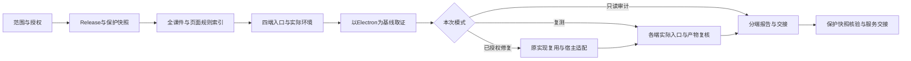

# Electron 显示对齐工作流

以指定 GitHub Release 的 Electron 为唯一显示基线，对照全部课件，在 Web、Server、Android 分别审计、按授权修复和复测。工作流入口是仓库内的 [genoffice-electron-alignment 技能](../../.agents/skills/genoffice-electron-alignment/SKILL.md)。

## 使用

在 Codex 中调用：

```text
使用 $genoffice-electron-alignment：
项目：当前仓库
Release：https://github.com/genspark-ai/genoffice/releases/tag/vX.Y.Z
课件目录：/path/to/courseware
模式：只读审计 / 修复指定问题 / 复测已有产物
依赖：禁止安装 / 允许安装
既有清单与接受设计：按当前授权给出编号及依据
输出目录：/path/to/audit-runs/run-unique-id
```

新审计、接续修复和只复测可独立执行；之前明确授予的权限不重复申请。仅整理/调用技能不自动启动业务审计，也不自动安装、提交或发布。



## 执行材料

- [详细阶段与结束条件](../../.agents/skills/genoffice-electron-alignment/references/workflow.zh-CN.md)
- [证据、问题字段与统计口径](../../.agents/skills/genoffice-electron-alignment/references/evidence.zh-CN.md)
- [五部分报告模板](../../.agents/skills/genoffice-electron-alignment/assets/report-template.zh-CN.md)
- [新运行清点与保护脚本](../../.agents/skills/genoffice-electron-alignment/scripts/audit_run.py)：只读输入、写独立运行目录，不作显示验收。

受当前 [AGENTS.md](../../AGENTS.md) 与 [Viewer移植规则](../viewer-porting-rules.zh-CN.md) 约束。核心要求：三端分别真实验证、保护基线、主包优先、来源可追溯；接受设计与修复关闭分列，无法确认/课件未定义不记为通过。

## 已有案例入口

[v0.13.18实施与复测记录](../viewer-electron-display-alignment.zh-CN.md) 是工作流来源案例。其中问题编号、设备、端口、通过数、接受设计与残余状态仅属于当次记录，执行新版本时须重新核实。本次整理工作流没有重新复测或改变其中的验收结论。
